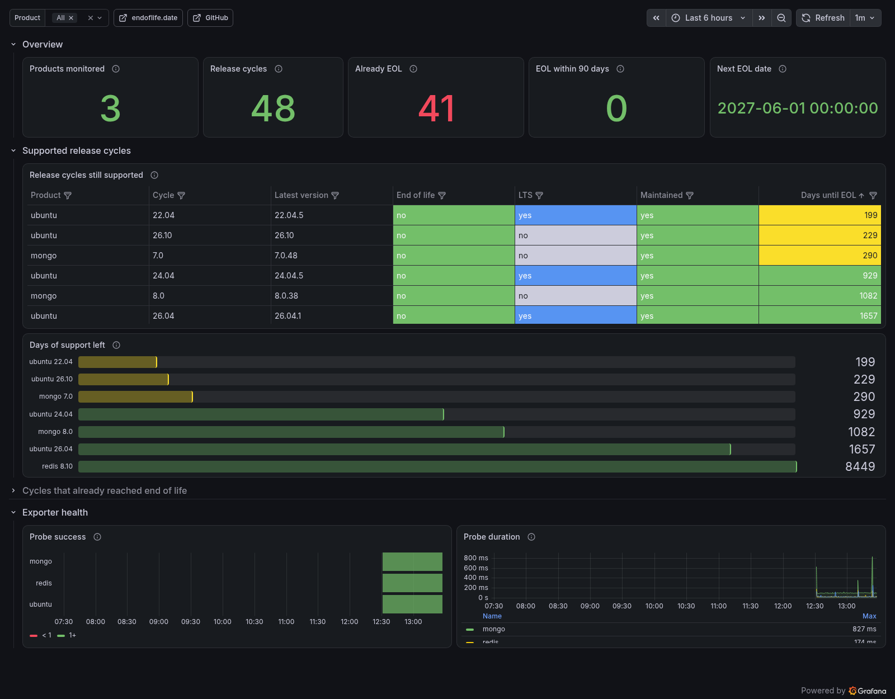

# End-of-Life Exporter

<p align="center">
  
  
  <br>
</p>

<p align="center">
  <a href="https://github.com/veerendra2/endoflife_exporter/actions"></a>
  <a href="https://github.com/veerendra2/endoflife_exporter/releases"></a>
  <a href="https://github.com/veerendra2/endoflife_exporter/blob/main/LICENSE"></a>
  <a href="https://github.com/veerendra2/endoflife_exporter/stargazers"></a>
  <a href="https://github.com/veerendra2/endoflife_exporter/network/members"></a>
  <a href="https://ghcr.io/veerendra2/endoflife_exporter"></a>
</p>

A Prometheus exporter that exposes product versions and their End-of-Life (EOL) dates as metrics using the [endoflife.date](https://endoflife.date) API. It follows the [multi-target exporter pattern](https://prometheus.io/docs/guides/multi-target-exporter/): Prometheus names the products to check, and the exporter fetches them on demand when Prometheus scrapes `/probe`.

## Deployment

### Usage

```bash
Usage: endoflife_exporter [flags]

Prometheus exporter for product versions and their End-of-Life.

Flags:
  -h, --help                    Show context-sensitive help.
      --address=":8080"         The address where the server should listen on ($ADDRESS).
      --log.format="console"    Set the output format of the logs. Must be "console" or "json" ($LOG_FORMAT).
      --log.level=INFO          Set the log level. Must be "DEBUG", "INFO", "WARN" or "ERROR" ($LOG_LEVEL).
      --log.add-source          Whether to add source file and line number to log records ($LOG_ADD_SOURCE).
      --version                 Print version information and exit
```

### Docker Compose

```yaml
---
services:
  endoflife_exporter:
    image: ghcr.io/veerendra2/endoflife_exporter:latest
    container_name: endoflife_exporter
    restart: unless-stopped
    environment:
      ADDRESS: ":8080"
      LOG_FORMAT: "console"
    ports:
      - 8080:8080
```

```bash
docker compose up -d
```

## Probing

One product per request. Add a product and its releases to Prometheus's static config, and
Prometheus scrapes them through this exporter.

| Parameter  | Required | Description                                                                                      |
| ---------- | -------- | ------------------------------------------------------------------------------------------------ |
| `target`   | yes      | Product slug from [endoflife.date](https://endoflife.date/), e.g. `mongo`.                        |
| `releases` | no       | Comma-separated release cycles (`8.0,7.0`), or `all` for every cycle. Defaults to `latest`.        |

```bash
curl 'localhost:8080/probe?target=redis'
curl 'localhost:8080/probe?target=mongo&releases=8.0,7.0'
curl 'localhost:8080/probe?target=ubuntu&releases=all'
```

A failed probe still answers `200` with `endoflife_probe_success 0`; a bad request returns `400`.

## Prometheus Configuration

Example `prometheus.yml`:

```yaml
---
scrape_configs:
  - job_name: "endoflife_exporter" # The exporter itself
    static_configs:
      - targets: ["endoflife_exporter:8080"]

  - job_name: "endoflife_products" # One scrape per product
    metrics_path: /probe
    scrape_interval: 1m # must stay under Prometheus's 5m instant-query lookback
    scrape_timeout: 30s
    static_configs:
      - targets: ["mongo"] # Product slug from endoflife.date
        labels:
          releases: "8.0,7.0"
      - targets: ["redis"] # Defaults to latest
      - targets: ["ubuntu"]
        labels:
          releases: "all"
    relabel_configs:
      - source_labels: [__address__]
        target_label: __param_target
      - source_labels: [__param_target]
        target_label: instance
      - source_labels: [releases]
        target_label: __param_releases
      - target_label: __address__
        replacement: endoflife_exporter:8080
```

### Alerting Rules Example

```yaml
groups:
  - name: endoflife.rules
    rules:
      - alert: ProductVersionEOLReachingSoon
        expr: avg by (product_name, release_cycle_name) (endoflife_eol_from_timestamp_seconds - time()) < (21 * 24 * 3600)
        for: 1h
        labels:
          severity: error
        annotations:
          message: 'Product ''{{ $labels.product_name }}'' release cycle ''{{ $labels.release_cycle_name }}'' reached its End-of-Life on {{ ($value | timestamp "2006-01-02") }}.'
```

## Metrics

- `endoflife_product_info` — release cycle metadata (EOL/LTS/maintained flags, latest version)
- `endoflife_latest_version_timestamp_seconds` — release date of the latest patch version
- `endoflife_release_cycle_timestamp_seconds` — when the release cycle first launched
- `endoflife_eol_from_timestamp_seconds` — when support ends. Absent when endoflife.date has no EOL date
- `endoflife_probe_success` — whether the probe reached endoflife.date for this product
- `endoflife_probe_duration_seconds` — how long the probe took

## Grafana Dashboard

[Download the dashboard JSON](./assets/endoflife-grafana-dashboard.json), or use the one provisioned in `development/`. Cycles with no published EOL date show as `not published`.



## Development

Requires Go 1.27+ and [task](https://taskfile.dev/docs/installation).

For the whole stack (exporter + Prometheus + Grafana with the dashboard provisioned):

```bash
cd development
docker compose up -d --build
```

See [development/README.md](./development/README.md) for ports and how the probes are
wired up.

```bash
go mod tidy
task gen     # regenerate types from the OpenAPI spec
task test
task all     # fmt, lint, security, tests
```

`task --list` shows everything else.

### Update the OpenAPI spec

- Check https://endoflife.date/docs/api/v1/ for changes.
- Update pkg/endoflife/openapi.yaml if needed and run `task gen` again.
- The upstream spec is OpenAPI 3.1 but oapi-codegen needs 3.0: set `openapi: 3.0.3` and convert `type: [string, "null"]` to `type: string` + `nullable: true`.
- Check `git diff pkg/endoflife/types.go` afterwards: a changed field type (pointer vs non-pointer) can break `pkg/endoflife/endoflife.go`.
